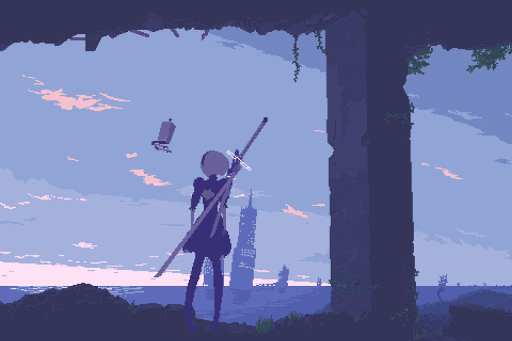
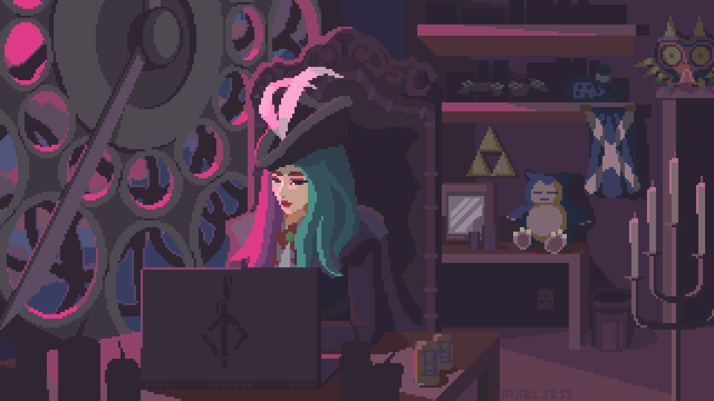

<!-- ═══════════════ ENCABEZADO ═══════════════ -->

  

  

  
  

<!-- ═══════════════ BANNER NIER ═══════════════ -->

  

<!-- ═══════════════ SOBRE MÍ ═══════════════ -->
## 🌙 Sobre mí

<!-- Escribe aquí tu descripción -->
Escribe aquí tu descripción.

<!-- ═══════════════ TECNOLOGÍAS ═══════════════ -->
## 🛠️ Tecnologías

<table align="center">
  <tr>
    <td align="center" width="160"><b>Lenguajes</b></td>
    <td></td>
  </tr>
  <tr>
    <td align="center"><b>Frameworks y motores</b></td>
    <td></td>
  </tr>
  <tr>
    <td align="center"><b>Bases de datos</b></td>
    <td></td>
  </tr>
  <tr>
    <td align="center"><b>Herramientas</b></td>
    <td></td>
  </tr>
</table>

<!-- ═══════════════ ESTADÍSTICAS ═══════════════ -->
## 📊 Estadísticas

  
  

  

  

<!-- ═══════════════ RINCÓN PIXEL ART ═══════════════ -->

  
<b>🕯️ Mi rincón pixel art</b> (clic para abrir)

   
  

    
  

  
Arte de PixelJess

<!-- ═══════════════ PIE ═══════════════ -->

  

